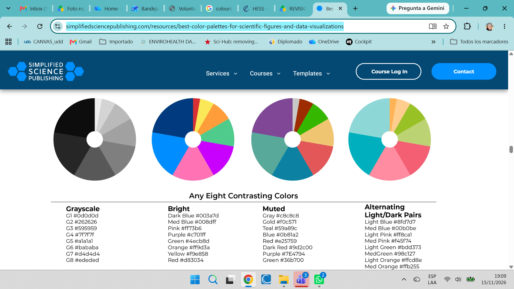
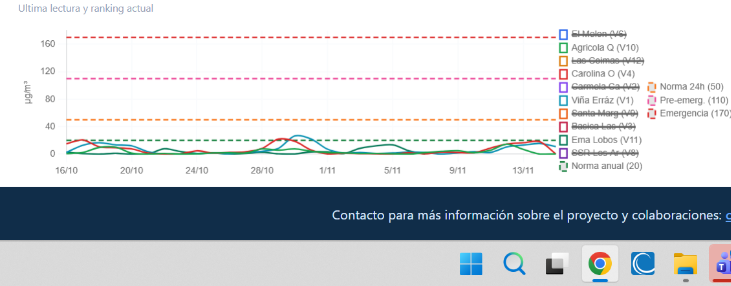

# Cambios v1: requisitos y revisión

Este documento reúne los mensajes recibidos y los requisitos del Word adjunto
`Sitio web Voluntarios por el Agua2026.docx`, incluidos sus comentarios. Los
mensajes originales se conservan al final. El estado se contrastó con
`docs/index.html` y `docs/app.js`; una solicitud no se considera aplicada solo
por estar mencionada en este documento.

## Disclaimer y descarga de datos

**Estado: parcial.** La web incluye un aviso «Sobre los datos» debajo de las
estadísticas, pero resume el texto solicitado. Omite la hora de medición, la
intención de seguir los protocolos de datos abiertos de UNESCO y la explicación
del esfuerzo por obtener la mayor precisión posible con los instrumentos
disponibles. El contacto está en otra sección. El Word vincula el aviso con el
botón de descarga; actualmente los botones están arriba de los gráficos y el
aviso al final de la sección, sin un enlace entre ambos.

Texto completo solicitado en el Word, con correcciones de redacción:

> Los datos son recopilados por voluntarios con instrumentos calibrados por los
> propios voluntarios. Este es un proyecto de ciencia ciudadana que procura
> obtener datos tan precisos como sea posible con los instrumentos disponibles,
> aunque estos instrumentos no están certificados por la DGA. Queremos seguir
> los protocolos de datos abiertos de UNESCO y dejar los datos descargables como
> datos mensuales por sitio. Pedimos un uso responsable de los datos, teniendo
> en cuenta el contexto de las mediciones (ubicación, fecha y hora) y las
> condiciones climáticas recientes. Si utiliza los datos o gráficos de este
> sitio web, dé crédito a Voluntarios por el Agua. Para más información sobre el
> proyecto y colaboraciones, contáctenos en Instagram: @voluntariosxelagua.

La mención de UNESCO expresa una intención del proyecto, no una certificación
ni un cumplimiento ya verificado. La referencia a la hora forma parte del
contexto de interpretación; no implica que la planilla registre ese dato.

**Pendiente:** completar el aviso y hacerlo accesible junto a la descarga. El
Word no exige una ventana de aceptación. Los botones actuales descargan todos
los registros en CSV o JSON, sin aplicar los filtros visibles; queda pendiente
la descarga por sitio descrita en el Word y explicar el alcance de la descarga.

## Requisitos del Word que faltaban en este registro

| Requisito | Estado observado en la web |
| --- | --- |
| Cuatro secciones: series de tiempo, mapa, fotos y proyecto. | Aplicado. |
| Temperatura del agua inicial y selección de parámetros. | Aplicado; también se ofrece turbidez, presente en la planilla aunque no está en la lista del Word. |
| Gráficos por año hídrico, de abril a marzo, desde 2022–2023 hasta 2026–2027 y ampliables al llegar datos. | Implementados a partir de los años presentes en los registros. El sexto panel del boceto corresponde a 2027–2028; no se crea vacío. |
| Elegir una o varias estaciones y consultar promedio, mínimo y máximo. | Aplicado mediante filtros y resúmenes por estación. |
| Referencias de pH 6,5–8,7 y conductividad menor que 1900 µS/cm. | Se muestran como referencias indicadas por el proyecto. Falta confirmar la fuente y el alcance para presentarlas como normas. |
| Mapa de siete estaciones, con colores, leyenda, selección de estación y parámetro, mediciones y resumen. | Implementado; las coordenadas siguen sujetas a validación del sistema de referencia y de los puntos repetidos de Guayacán. |
| Línea de tiempo para avanzar por las mediciones del mapa. | Parcial: existe un selector de año hídrico, sin línea de tiempo ni navegación mensual. |
| Fotografías mensuales de Guayacán, San Gabriel y Baños Morales, con navegación entre fotos y resúmenes. | Implementado. Los adjuntos anunciados y no recibidos se detallan en `revision-aplicada.md`. |
| Explicar el proyecto, frecuencia mensual, continuidad de los puntos, instrumentos y medición ocasional de bacterias. | Aplicado; el texto público indica monitoreo mensual, sin precisar el primer domingo. |
| Formulario de contacto dirigido a `zoefleming24@gmail.com`. | Pendiente: solo se ofrece contacto por Instagram. |
| Instagram `@voluntariosxelagua`, informe del primer año y dos videos de YouTube. | Aplicado. |
| Video de Vimeo desde el minuto 20. | Pendiente: el Word lo menciona sin entregar la URL. |
| Puntos de encuentro con coordenadas y altitud. | Pendiente: no aparecen en la web. Son distintos de las estaciones de muestreo. |
| Fotografías del equipo y los instrumentos al final, y logo destacado arriba. | Aplicado. |
| Actualización mensual con datos recibidos en KoboCollect después del primer domingo. | Pendiente de integración: actualmente se genera el sitio desde el Excel local. La carga automática de fotos también queda para una etapa posterior. |

### Puntos de encuentro solicitados

Transcripción de los valores del Word, con Guayacán en lugar de El Manzano.
El documento rotula las longitudes como «E», aunque los valores son negativos;
se conservan los valores y se deja pendiente validar esa notación antes de
publicarlos.

| Sector | Latitud | Longitud | Altitud |
| --- | --- | --- | --- |
| Canelo | -33.576468 | -70.452054 | 790 m |
| Guayacán | -33.601013 | -70.359791 | 878 m |
| San Gabriel | -33.786392 | -70.229894 | 1257 m |
| Baños Morales | -33.826691 | -70.064452 | 1802 m |

## Cambios solicitados en los mensajes y comentarios

- Reemplazar El Manzano por Guayacán en Excel, etiquetas de fotos y puntos de
  encuentro. Aplicado en nombres públicos y planilla; los puntos de encuentro
  todavía no se publican y algunas fotos históricas conservan el nombre dentro
  de la imagen.
- Mejorar la distinción entre estaciones con una paleta accesible y evitar el
  arcoíris. Aplicado mediante colores, trazos y símbolos; los detalles y límites
  de las comprobaciones están en `revision-aplicada.md`.
- Usar triángulos para Canelo · Maipo, Guayacán · Maipo y San Gabriel · Maipo;
  distinguir las otras cuatro estaciones con círculos. Aplicado.
- Permitir ocultar estaciones para comparar solo dos o tres. Aplicado con
  casillas individuales y selección de grupos.
- Destacar el logo original en la parte superior y usar las fotos de mejor
  calidad recibidas. Aplicado.
- Retirar San Alfonso, Canelo y Puente Alto de las fotos repetitivas. Aplicado;
  esto no elimina Canelo de las estaciones de medición.
- Incorporar dos fotos adicionales de Guayacán y tres resúmenes actualizados en
  «Otros». Parcial: se incorporó el resumen disponible de Guayacán extraído del
  Word; faltan las dos fotos individuales y los nuevos resúmenes independientes
  de San Gabriel y Baños Morales anunciados en el mensaje.

## Mensajes originales recibidos

colegas de Voluntarios por el Agua y algunos pequeñas errores a reportar!

Primero, no quieren llamar el sitio El Manzano así, quieren llamarlo Guayacan, así esto significa cambiarlo en el excel de datos, en las fotos repetitivas y en punto de encuentro..

Segundo, me comentaron que los colores no se ven suficientes diferentes. Te puedo ayudar con esto de elegir paletas de colores más diferentes y si problemas de daltonismo etc..

Tercero, el logo tiene que aparecer bastante arriba... Te lo mando aqui, ademas de las fotos que incluí, así se ven de buena calidad.. Y también mando las foto repetitivas de "otros" actualizados...

Cuarto - Foti repetitivas - Queremos sacar San Alfonso, Canelo y Puente Alto de las fotos repetitivas, por favor. Y perdón, añadi 2 fotos que faltaba de Guayacan (ex - el Manzano). Y mando las 3 resumenes para "otros"

Aqui mando el documento original con comentarios..

Gracias,

Hola Alejandro,
Gracias!
Yo creo que sería bueno distinguir entre 
Canelo Maipo
Guayacan Maipo
San Gabriel Maipo
Capaz con un simbolo de triangulo en vez de circulo para cada mes

y 4) Guayacan Colorado
5) San Gabriel Yeso
6) Baños Morales Volcan
7) Baños Morales Estero

El IPCC tiene este guia, y colores está en p.13
https://www.ipcc.ch/site/assets/uploads/2022/09/IPCC_AR6_WGI_VisualStyleGuide_2022.pdf
Y esto habla de no usar la paleta del arco iris https://www.climate-lab-book.ac.uk/2014/end-of-the-rainbow/
y esto tambien https://hess.copernicus.org/articles/25/4549/2021/hess-25-4549-2021.html

Pero mira esto - combinaciones de colores para 6 o 8 diferentes cosas en un grafico - https://www.simplifiedsciencepublishing.com/resources/best-color-palettes-for-scientific-figures-and-data-visualizations

Lo importante es tener algo que hace que los 3 del Maipo son reconocible por el simbolo.

Es el tipo de grafico donde se podría sacar ríos, para solo mostrar 2 o 3? Como los de https://cmasudd.github.io/aireaconcagua/ donde se puede pinchar para sacar? Porque mirar 7 ríos a la vez es dificil

Gracias!
